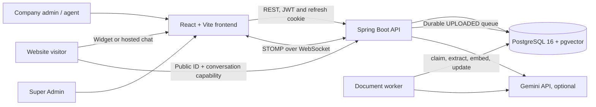

# SupportIQ Architecture

## Components

## Request and trust boundaries

- The browser is untrusted. Company staff APIs derive company scope from a validated short-lived JWT. Company IDs supplied in request data do not set staff scope.
- Visitors use a public company identifier to start a chat and receive a separate high-entropy conversation capability. Later transcript access is checked against both the company and that capability. Public widget CORS is credential-free; staff APIs use one configured frontend origin.
- Spring Security applies role gates to platform, billing, knowledge, orders, team, and agent workspace routes. Service queries bind parameters and constrain tenant-owned rows.
- Refresh tokens are random, hashed at rest, rotated in HttpOnly SameSite=Strict cookies, and revocable. Passwords use BCrypt. Auth state-changing calls are origin-checked.

## Knowledge and RAG path

1. The API validates file size, extension, signature, and text content, stores the original in PostgreSQL, and persists an `UPLOADED` job state.
2. A local executor or dedicated worker atomically claims only rows still marked `UPLOADED`, then extracts PDF, DOCX, text, or Markdown content and splits page/section-aware chunks.
3. Chunks receive 768-dimensional Gemini embeddings when configured, or deterministic local feature-hash vectors without a key. Chunk rows include company and document IDs and pgvector representation.
4. Retrieval filters by the active company, ranks by vector similarity, and applies the configured relevance threshold. Only retrieved approved text is passed to answer generation.
5. Without Gemini generation, matching source sentences can be returned extractively; weak or absent matches use the configured safe response and handoff. Citations come from retrieved database rows rather than model output.

## Durable worker path

`UPLOADED` is the durable queue state. Claiming uses a conditional transition to `PROCESSING`; competing workers only proceed when their update changed one row. Success stores chunks and marks the document `READY` in a transaction. Failures retain a bounded error and become `FAILED`. Stale `PROCESSING` rows are requeued or failed after the configured age/attempt ceiling. This is database-backed polling, not an external broker.

## Chat and realtime path

- Customer widget, hosted chat, company dashboards, and agent inbox use the same tenant-owned conversation and ticket records.
- Customer STOMP connections prove company public ID, conversation ID, and capability. Staff connections prove the JWT, role, active account, and tenant membership.
- Messages and notes persist before publishing. Customer-visible messages and internal staff notes have separate visibility rules. REST history remains available as the widget reconnect/poll fallback.

## Persistence and deployment

- Flyway V1–V6 owns relational schema changes; Hibernate schema mutation is disabled.
- PostgreSQL stores tenant data, vector chunks, uploaded originals, and chat attachments. Local Compose uses a named persistent volume. Render configuration targets a separate managed PostgreSQL database and same-region worker; it must not use the local database.
- Frontend, API, and worker are separate containers. The worker profile is optional locally; production config uses a dedicated worker and durable queue dispatch.
- Billing and refunds use explicitly marked DEMO providers. No real payment provider or email delivery adapter is included.

See [SECURITY_REVIEW.md](SECURITY_REVIEW.md), [AI_RAG_ARCHITECTURE.md](AI_RAG_ARCHITECTURE.md), [BILLING_ARCHITECTURE.md](BILLING_ARCHITECTURE.md), and [DEPLOYMENT_GUIDE.md](DEPLOYMENT_GUIDE.md).
