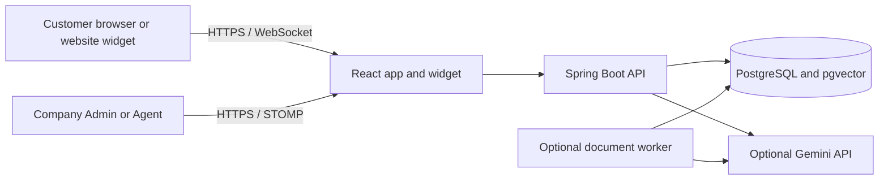

# SupportIQ

SupportIQ is a multi-tenant customer support SaaS portfolio project. It brings company knowledge, customer conversations, agent operations, order support, and subscription usage into one workspace. Businesses can add a support widget to their website, while customers can chat without creating a SupportIQ account.

## Features

- Company registration, onboarding, role-based access, agent invitations, and tenant-scoped data.
- Company-customized website widget and standalone support pages, with anonymous customer conversations and capability-scoped history.
- Knowledge uploads for PDF, DOCX, TXT, and Markdown; document processing, chunking, vector retrieval, citations, and safe handoff.
- Optional server-side Gemini generation and embeddings; local deterministic embeddings and extractive/fallback answers work without a Gemini key.
- Real-time customer and agent messaging, assignment, ticket status, internal notes, presence, notifications, and SLA settings.
- Company orders, tracking, refund review, subscription plans, usage limits, analytics, and a protected platform operator workspace.
- Docker Compose setup, PostgreSQL persistence, Flyway migrations, and an optional background worker.

## Technology

| Area | Technology |
|---|---|
| Frontend | React, Vite, JavaScript |
| Backend | Java 21, Spring Boot, Spring Security, REST, STOMP/WebSocket |
| Data | PostgreSQL 16, pgvector, Flyway, JDBC |
| AI | Google Gemini API (optional), tenant-scoped retrieval, deterministic local embeddings and fallback |
| Runtime | Docker, Docker Compose, Nginx |

## Architecture



Staff requests are authorized using their account role and company scope. Public customer conversations use a company public identifier and a per-conversation capability token. Document chunks and conversations are stored with company ownership. Gemini credentials are read by the backend or worker and are never intended for the frontend.

## Local setup

### Requirements

- Docker Desktop with Docker Compose v2.
- Network access for the first image build and dependency downloads.
- Optional: Node.js 20+ to run frontend checks outside Docker.

### Start the application

Clone the repository, open a terminal in its root, and run:

```powershell
docker compose up -d --build postgres backend frontend
```

Check service health:

```powershell
docker compose ps
Invoke-RestMethod http://localhost:8080/api/v1/health
```

Open the frontend at [http://localhost:5173](http://localhost:5173). The API health endpoint is [http://localhost:8080/api/v1/health](http://localhost:8080/api/v1/health), and the OpenAPI interface is [http://localhost:8080/swagger-ui/index.html](http://localhost:8080/swagger-ui/index.html).

The database is stored in the named `supportiq_pgdata` Docker volume. Stop local services while preserving data with:

```powershell
docker compose stop backend frontend postgres worker
```

Do not use `docker compose down -v` if you want to keep the database volume.

### Environment configuration

Compose has development-only defaults and can start without a `.env` file. To customize settings, copy `.env.example` to `.env` and replace each `replace-with-*` value with a unique local value. For an already initialized database volume, keep `POSTGRES_PASSWORD` consistent with the password used when that volume was created; changing the environment value alone does not rotate the database password.

Gemini is optional. Set `GEMINI_API_KEY` in the ignored `.env` file to enable server-side Gemini answer generation and the default Gemini embedding key. You may set `GEMINI_EMBEDDING_API_KEY` separately. Never use a `VITE_` variable for these keys or add them to browser code. Without a key, the app uses deterministic local embeddings, extractive matching, safe fallback, and handoff behavior.

For local demo accounts, review `SEED_DEMO_ADMIN`, `DEMO_ADMIN_EMAIL`, and `DEMO_ADMIN_PASSWORD` in `.env.example` and set a private local password before sharing access. Local fallback values are for development only and must not be used for a hosted deployment.

### Optional document worker

By default, the backend processes document jobs. For the separate worker profile, set `AI_PROCESSING_DISPATCH_LOCALLY=false` in `.env`, then start it with:

```powershell
docker compose --profile dedicated-worker up -d --build worker
```

Do not enable both processors when a single worker is desired.

## Tests

Backend integration tests use the isolated `phase7_test` PostgreSQL schema:

```powershell
docker compose --profile test run --rm backend-tests
```

Frontend checks (Node.js 20+):

```powershell
Push-Location frontend
npm ci
npm test -- --run
npm run build
npm audit --audit-level=high
Pop-Location
```

The latest recorded local run passed 27 backend tests and 5 frontend tests. The backend tests include mocked Gemini request and failure cases; they do not prove live Gemini access. See [TEST_RESULTS.md](TEST_RESULTS.md) and [SECURITY_REVIEW.md](SECURITY_REVIEW.md) for verification scope.

## Project documentation

- [Architecture](ARCHITECTURE.md)
- [Local setup](LOCAL_SETUP_GUIDE.md) and [troubleshooting](LOCAL_TROUBLESHOOTING.md)
- [Environment variables](ENVIRONMENT_VARIABLES_REFERENCE.md)
- [Demo walkthrough](DEMO_GUIDE.md) and [interview guide](INTERVIEW_GUIDE.md)
- [Known limitations](KNOWN_LIMITATIONS.md)
- [Deployment preparation](DEPLOYMENT_GUIDE.md)

## Current Limitations

- Live Gemini API calls have not been verified in this local environment because no API key is configured.
- The local no-key answer path is extractive and uses deterministic hash embeddings; it is not a generative model or broad semantic model.
- Order and subscription payments are demo-only. Email delivery and production deployment are not configured or verified.
- This project has not completed an external penetration test or production operations review.

SupportIQ is an actively demonstrable local SaaS project. The limitations above should be addressed before using it with real customers or payment data.
